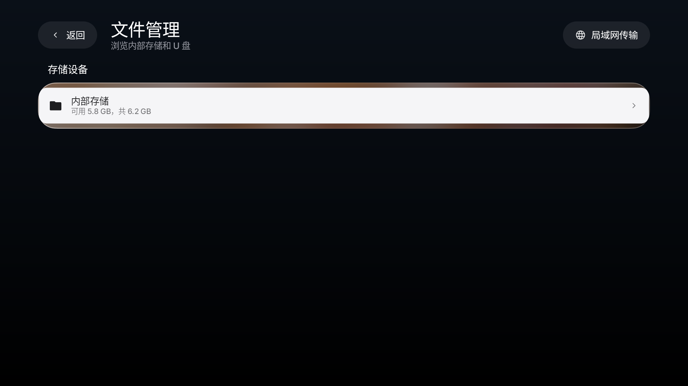

# 文件管理

这是本分支新增的功能，在官方 Aerial 的应用网格中加入一个「文件管理」磁贴。它属于 Aerial 本身（不是单独安装的 App），可以和其他 App 一样移动、放进文件夹或隐藏。



## 能做什么

- **浏览存储**：内部存储、U 盘 / SD 卡（Android 5–10 用外部存储权限，Android 11+ 用「所有文件访问」）。
- **打开文件**：目录按名称排列、文件夹优先；选中文件后交给电视上已有的应用打开。APK 会交给系统安装器。
- **局域网传输**：在文件管理右上角点「局域网传输」，电视显示二维码和地址。手机连同一个 Wi-Fi 扫码后可以：
  - 一次选择多个文件上传到电视；
  - 查看、下载电视上的文件；
  - 文件保存在内部存储的 `AerialDrop/` 文件夹，会立即出现在文件管理里。

## 权限

Android 11 及以上需要「所有文件访问」权限。可以在这台电视的设置里打开，或用 ADB：

```bash
adb shell appops set app.orchard.tv MANAGE_EXTERNAL_STORAGE allow
```

文件管理会把权限状态显示出来；没有权限时只能进入授权页，不会假装能浏览。

## 局域网传输的安全与限制

- 只在传输面板打开时启动，面板关闭即停止；使用 8 位随机路径令牌，二维码里带令牌。
- 服务端口 `8791`，只接受手机页面里的上传和下载；不提供任意路径浏览。
- 上传文件保存在 `AerialDrop`，文件名会去掉路径并去重；单次上传上限 512 MB。
- 是局域网 HTTP，不经过公网；同一 Wi-Fi 下拿到二维码/地址的人可以访问，传完请关闭面板。
- 目前不支持在电视端重命名、删除、复制或移动文件，也不支持从手机浏览 `AerialDrop` 以外的目录。

## 构建

```bash
./gradlew assembleStandardRelease assembleGuardRelease
```

APK 在 `app/build/outputs/apk/standard/release/` 和 `guard/release/`。本分支使用本机 debug 签名，装过官方 Aerial 的电视需要先卸载官方版（会丢它自己的设置与照片），再安装本分支；`standard` 和 `guard` 的选择与官方一致。
